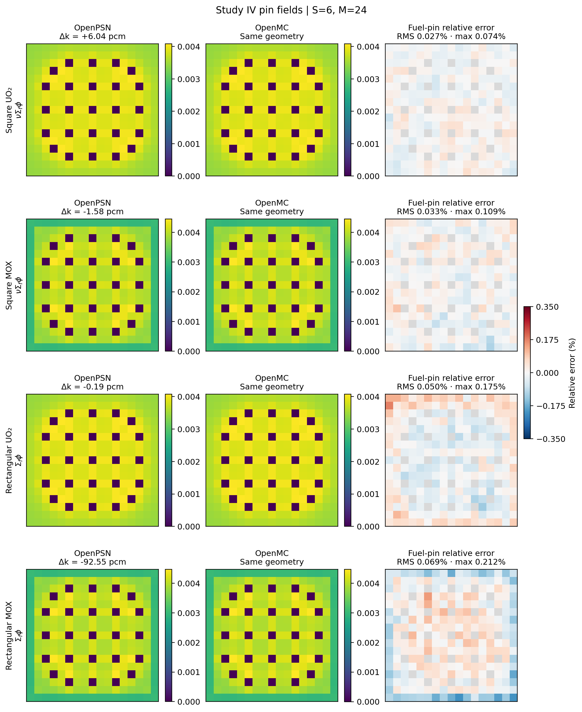
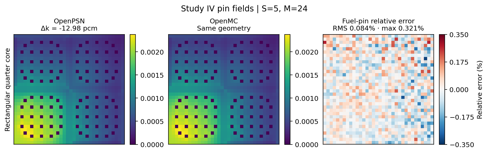

## Study IV --- the finite-sector diffusion closure

Study III added even-parity angular modes inside each angular segment and changed the body closure. This section assesses the branch that keeps the PSN idea in its literal form: the transport equation is reduced, per finite angular cell, to a diffusion-type equation whose coefficients are the exact second-moment tensor of the directions in that cell, and the resulting systems are assembled over space exactly as a diffusion calculation would be. The branch reduces that tensor two ways with equal angular unknown counts: at azimuthal degree $A$ each sector carries $K{=}A{+}1$ angular unknowns either way. In `sector_diffusion` they are the $A{+}1$ Gauss directions of the sector, each retaining its own tensor; in `sector_average` they are the cell mean of the tensor plus $A$ local azimuthal modes ($A{=}0,\ldots,4$) inside the cell. The direction-wise `sector_diffusion` is the closure of record in this section and the default of the driver named below, at $A{=}3$ unless the input asks otherwise; `sector_average` is kept as the comparison at equal degrees of freedom. The quarter-core matrices and @@TAB:tab:study4-checker-sector@@ were measured with the direction-wise closure, @@TAB:tab:study4-checker@@ repeats the same checkerboard grid with the cell-average one point for point, and the ratio of the two errors is quoted at each of the @@PAIR_COUNT@@ points measured both ways. The direction-wise re-sweep covers 458 points, comprising 314 checkerboard and 144 assembly points. The archive retains the cell-average matrices separately in the same per-point files. The last 18 rectangular cells used packed Cholesky preconditioning and FP64 residual-checked PCG. Their planned coordinates and budgets are in `paper/data/uniform/plan_packed.json`. `scripts/study4_sm_figures.py` redraws the matrices and the quarter-core panel from the tracked data. The ten `strict_phase_space` rows kept in the same checkerboard data file are neither closure: they insert the exact sector tensor into the original four-mode body and face-average matching, and are quoted only where the published valley is located. Both closures are selected from the input file (`angular.model: generic`, `angular.closure: sector_diffusion` or `sector_average`, `angular.azimuth_degree`, `angular.polar_degree`, `angular.slope_space`); the driver `scripts/sector_diffusion_benchmark.py` reproduces every point below, `scripts/study4_closure_report.py` rebuilds the two checkerboard matrices, their point-by-point ratio table and `paper/data/study4_closure_pairs.csv` from the same records, `scripts/study4_closure_cost.py` measures the matched cost pairs, `scripts/study4_uniform_grid.py` runs and merges the re-sweep, and `scripts/study4_core_report.py` rebuilds the core tables from the recorded run logs. The same closure is written up on its own terms in `paper/sector_method.tex` --- even-parity reduction, sector tensors, the counterexamples that bound the word "exact", the test-problem inventory and the cost records --- which compiles and reads independently of this paper and shares its generated tables.

#### Formulation.

Inside a material-constant node, decomposing the angular flux into its even and odd parts under $\boldsymbol{\Omega}\rightarrow-\boldsymbol{\Omega}$ gives, for isotropic scattering and fission, the exact relation $\psi^{-}=-(\boldsymbol{\Omega}\cdot\nabla u)/\Sigma_t$ for the even-parity flux $u$. Eliminating $\psi^{-}$ yields, for each retained direction,

$$-\nabla\cdot\!\left(\frac{\boldsymbol{\Omega}\boldsymbol{\Omega}^{\mathsf T}}{\Sigma_t}\nabla u\right) +\Sigma_t u = q ,$$

with the vacuum boundary condition carrying $|\boldsymbol{\Omega}\cdot\mathbf{n}|u$ and specularly reflected directions sharing the trace value on the reflecting face. That equation is discretised in space by continuous biquadratic Lagrange nodes, with the body diffusion term, the normal current across material interfaces and the vacuum term taken from one weak form, so no separate face-current model is introduced. Scattering and fission are projected onto nine orthogonal spatial moments per material node. Azimuth is split into $M$ sectors per half-plane, each carrying $A{+}1$ Gauss directions; polar angle uses Gauss nodes ($I/2$ per half-axis) or the existing three-point TY3 rule. The tensor $\langle b_a\,\boldsymbol{\Omega}\boldsymbol{\Omega}^{\mathsf T}b_b\rangle/\Sigma_t$ is integrated analytically over each finite cell, and its $xy$ component is retained, so two directions in one sector that differ only in sign of $\Omega_x\Omega_y$ are not collapsed. For the mirrored quadrant-symmetric assemblies, complementary azimuths are solved once and applied by the spatial transpose.

Two reductions were verified algebraically rather than numerically. Setting `angular.node_response: true` rewrites the same weak form as a shared face-trace system, $R=\mathsf{K}_{II}^{-1}\mathsf{K}_{IB}$, $\mathsf{T}_B=\mathsf{K}_{BB}-\mathsf{K}_{BI}R$, $\mathbf{g}_B=\mathbf{f}_B-R^{\mathsf T}\mathbf{f}_I$, with the nodal interior recovered afterwards. Because $\mathsf{K}_{II}$ is block-diagonal per node, this is an exact elimination of the interior degrees of freedom. The repository checks it two ways: on a three-material rectangle, in four different spatial and angular subspaces and two of them in the reflection-invariant subspace, the condensed trace solve reproduces a direct sparse solve of the full angular matrix to $2\times10^{-11}$, and on the strong checkerboard the eliminated and direct systems give the same eigenpair to a relative tolerance of $2\times10^{-9}$ with the spatial and angular test spaces unchanged. Changing $A$, by contrast, changes the test space, and its effect is measured below. A second check concerns what a finite angular closure can and cannot achieve: for a purely absorbing slab, the map from an incident angular profile $g(\mu)$ to the exit profile is $e^{-T/\mu}g(\mu)$, which is injective on angular functions, so any fixed number of retained angular moments admits two incident profiles with identical moments and different outgoing states. A reflective slab with a cosine source gives a response coefficient of $\pi/4$ when the direction-wise solution is averaged after the fact and $3/4$ when the diffusion tensor is averaged over angle first. Exact transfer between nodes therefore requires a continuous face function, and $S$ and $M$ then only partition the phase space. This is the sense in which the closure is "strict": the algebra is exact up to the chosen finite spatial and angular spaces, and no additional face-current model is hidden in the assembly.

#### The diagonal valley of the square checkerboard.

On the one-group square checkerboard of the original paper the published PSN errors change sign along a diagonal valley whose position moves with $S$: at $I{=}30$ the strong-absorber row $S{=}2$ crosses between $M{=}4$ and $M{=}8$ ($-790.22$ pcm at $M{=}4$, $+807.92$ pcm at $M{=}8$), the $S{=}4$ row between $M{=}8$ and $M{=}12$, and the $S{=}6$ and $S{=}8$ rows between $M{=}12$ and $M{=}24$. Replacing only the node-interior diffusion coefficient by the exact sector tensor, while keeping the original four-mode body and face-average matching, does not remove the crossing ($-1363.03$ pcm and $+76.41$ pcm on the same two points), which locates the sign change in the face closure rather than in the body tensor alone.

With the direction-wise closure the crossing is absent from every part of the grid but one column. @@TAB:tab:study4-checker-sector@@ prints the archived grid; the direction-wise closure has since been measured at 314 points at $A{=}0,1,2$, $S{=}1,\ldots,20$, $M{=}2,\ldots,96$ on the two absorbers --- every point of the archived grid plus the wide $A{=}1$ scan of $S{=}1,\ldots,20$ against $M{=}2,4,8,12,16,24$ --- with no scheduled cell left blank; its largest independent verification residual is $3.9\times10^{-9}$ in the source and $1.0\times10^{-9}$ in the eigenvalue. 279 of the 314 errors are negative. The 35 positive ones are one column, $A{=}1$ at $M{=}4$ --- $S{=}3,\ldots,20$ of the strong absorber, $+7.1$ to $+127.4$ pcm, and $S{=}4,\ldots,20$ of the weak one, $+6.7$ to $+18.2$ pcm --- where a sector holds two Gauss directions. It is not the coarsest azimuth tested ($M{=}2$ of the same scan is one-signed at all twenty of its points on each absorber), and a direction-wise tensor needs no quadrature of the cell it averages, so the archived explanation of those crossings, an under-integrated sector tensor, does not carry over: it is the one property of the measured closure the algebra leaves unexplained. Of the 280 steps that refine $S$ at fixed $M$, 246 move the error toward zero. The other 34 lie in the positive-column region. Past $M{=}12$ each $A,S$ column settles within $6.8$ pcm of its own best. Halving a sector replaces the retained directions; the one wider first azimuthal step is $M{=}8$ of the $A{=}0$, $S{=}12$ strong-absorber scan, at $-22.40$ pcm before that scan's $-8.38$ pcm at $M{=}12$.

The default $A{=}3$ was tested at another 240 checkerboard points for both absorbers, $S{=}1,\ldots,20$, $M{=}2,4,8,12,16,24$ and $I{=}30$. All differences are negative. All 228 spatial refinements and 155 of 200 azimuthal refinements reduce the absolute difference. Both best points are at $(S,M)=(20,8)$, with $-6.19$ pcm (strong) and $-2.65$ pcm (weak). With $A{=}2$ all 40 $M{=}4$ points are negative, and both $S{=}20,M{=}2$ points overshoot. The per-point controls, residuals and timings are archived in `paper/data/study4_checker_azimuth_controls.csv`.

@@SECTOR_TABLE@@

@@CHECKER_TABLE@@

@@TAB:tab:study4-checker@@ is the archived comparison, and a demanding one: the same grids measured with the tensor averaged over the sector first. All 130 points of its four scans are one-signed and monotone along both axes, with largest independent verification residual $3.2\times10^{-9}$ in the source and $9.7\times10^{-10}$ in the eigenvalue; `scripts/study4_checkerboard_report.py` reads their run logs from `examples/psn_repro/logs/`, re-checks both properties and regenerates the table. The two closures share $A$, $S$, $M$ and $I$ wherever they meet, so they may be differenced point by point: over the @@PAIR_COUNT@@ such points the direction-wise error is smaller at @@PAIR_SMALLER@@, with a median ratio of $@@PAIR_MEDIAN@@$. The paired CSV locates all @@PAIR_SIGN_CHANGES@@ sign changes by case and grid point. The six rectangular UO$_2$ cells at $M{=}2$ have larger absolute errors in the direction-wise run, including $-204.0$ pcm against $-24.3$ pcm at $S{=}1$. At $A{=}0$, $S{=}12$, $M{=}12$ of the strong absorber the error is $-304.58$ pcm averaged over the sector and $-8.38$ pcm kept per direction; at $A{=}1$, $S{=}12$, $M{=}8$ it is $-77.88$ against $-5.73$ pcm, and for the weak absorber at the same point $-15.66$ against $-2.68$ pcm. Those are the best points of the new closure on the two problems, against $-32.05$ and $-7.85$ pcm for the archived closure on the same meshes, so the direction-wise tensor arrives at the smaller error with three times fewer azimuthal sectors --- and at the same cost, the two closures having the same unknowns: over the ten pairs run back to back on one host the median time ratio is $0.98$.

On the cell-average closure the azimuthal modes are what carry the error down: at $S{=}12$, $M{=}24$ the strong-absorber error falls from $-107.43$ pcm with the angular average to $-34.13$ pcm with one azimuthal mode and $-32.05$ pcm with two; representing the same mode in the bilinear subspace gives $-40.24$ pcm with fewer spatial degrees of freedom, and on this grid the bilinear point is also the cheaper of the two settings ($12.81$ s against $37.44$ s for the legacy node model at the same $S{=}12$, $M{=}24$; the two logs record neither thread count nor host load, so this pair is not a controlled timing comparison). The same closure is checked against an analytic solution rather than against itself: on the one-group slab with vacuum on both faces and no scattering, the angular-diffusion solution gives the cell-mean flux in closed form, and the discretised sweep is required to reproduce it (`tests/test_sector_diffusion.py`, `test_vacuum_slab_matches_analytic_angular_diffusion`, $A{=}1$, 32 cells, $I{=}4$, $M{=}4$, six digits).

#### Assemblies: six $S\times M$ matrices.

The cell-average comparison was then run as a full sweep on the four C5G7 assemblies and both checkerboards: $M{=}2,4,8,12,16,24$ against $S{=}1,\ldots,20$ for the checkerboards ($I{=}30$) and $S{=}1,\ldots,6$ for the assemblies ($I{=}8$ finite polar subdivisions), $A{=}1$ with the bilinear azimuth coefficients, 384 points in total. Each point passed its own verification sweep. The square model reuses the pin-homogenised cross sections of Study I and the rectangular model the explicit $3\times3$ tiling of Study II, with the same-geometry OpenMC references $1.3336285$ / $1.1853993$ (square UO$_2$ / MOX) and $1.3347260$ / $1.1851053$ (rectangular UO$_2$ / MOX).

<figure id="fig:study4-c5g7" data-latex-placement="H">

<figcaption>Signed eigenvalue differences for the pin-homogenised square and explicit rectangular C5G7 assemblies, in pcm against each same-geometry OpenMC reference. The marker indicates the smallest measured absolute difference in each panel.</figcaption>
</figure>

<figure id="fig:study4-fission" data-latex-placement="H">

<figcaption>Fuel-pin fission maps at the best measured points, from left to right OpenPSN, OpenMC and the relative pin error. The square rows use $\nu\Sigma_f\phi$, the rectangular rows $\Sigma_f\phi$, each normalised to unit pin sum as in the corresponding Study I and II figures.</figcaption>
</figure>

| Case                 | Best $(S,M)$ | $\Delta k$ (pcm) | Pin RMS | Pin max | Sum, 36--120 points |
|:---------------------|-------------:|-----------------:|--------:|--------:|--------------------:|
| Strong absorber      | $(20,24)$    | $-33.67$   | ---     | ---     | 140.1 s   |
| Weak absorber        | $(20,24)$    | $-7.76$    | ---     | ---     | 131.4 s   |
| Square UO$_2$        | $(6,4)$      | $+3.02$    | 0.029 % | 0.077 % | 492.9 s   |
| Square MOX           | $(6,24)$     | $-2.45$    | 0.033 % | 0.116 % | 502.6 s   |
| Rectangular UO$_2$   | $(6,24)$     | $-8.80$    | 0.050 % | 0.168 % | 3041.0 s  |
| Rectangular MOX      | $(6,24)$     | $-118.55$  | 0.079 % | 0.238 % | 2957.7 s  |

: Coverage, best measured point, fuel-pin error and wall time of the six $S\times M$ matrices. The sum column adds the individual point times; several cases ran concurrently on the same host. {#tab:study4-assembly}

<figure id="fig:study4-walltime" data-latex-placement="H">

<figcaption>End-to-end wall time of the same 384 points in seconds on a logarithmic scale; top to bottom, strong and weak absorber checkerboards, square UO$_2$ and MOX, rectangular UO$_2$ and MOX. Points were run several at a time on one host and the coarse points take under a second, so the panels describe workload rather than measured throughput.</figcaption>
</figure>

The rectangular MOX row is the weakest point of this sweep, and it is a material-and-tiling effect rather than an angular one: at fixed $M{=}24$, $A{=}2$ and one polar mode, its error reduces from $-185.20$ pcm at $S{=}1$ through $-115.02$ ($S{=}2$) and $-68.35$ ($S{=}4$) to $-52.81$ pcm at $S{=}6$, so spatial resolution of the explicit water gaps, not additional azimuth, carries the improvement there.

The direction-wise re-sweep covers all 458 planned points and all 36 cells of each assembly. The square UO$_2$ and MOX minimum absolute errors occur at $(3,2)$ and $(6,8)$, respectively. The completed rectangular grids give smaller best absolute errors with the direction-wise closure for both fuels. The comparison uses the signed eigenvalue differences, with the pin statistics and run times shown below.

@@ASSEMBLY_SECTOR_TABLE@@

<figure id="fig:study4-assembly-fields">

<figcaption>Study IV assembly pin fields at S=6, M=24. Square maps show neutron production. Rectangular maps use the material-average neutron yield of the archived fission-rate convention. The four relative-error maps cover 264 fuel pins per assembly and use a shared −0.35% to +0.35% scale.</figcaption>
</figure>

In the cell-average rectangular UO$_2$ study, the $S{=}2$ difference changes from $-91.65$ to $-148.98$ pcm from $M{=}2$ to $M{=}4$, a drop of $57.33$ pcm. Reassigning the six subintervals per pin axis from $2/2/2$ to $1/4/1$ with `--balance-pin` preserves every material interface and reduces the drop to $40.69$ pcm. In a separate test at $S{=}1$ on the uniform mesh, the higher spatial basis with $A{=}4$ gives $-71.17$ and $-33.21$ pcm. The controls are consistent with an interaction between coarse angular and intra-pin spatial resolution.

With direction-wise tensors at $A{=}1$, $k_{\mathrm{eff}}$ increases from $M{=}2$ to $M{=}4$ in all six UO$_2$ rows of both geometries. At $S{=}2$ the rectangular difference moves from $-204.06$ to $-122.77$ pcm, and the square difference moves from $+1.46$ to $+6.25$ pcm. The absolute error shrinks in the rectangular rows and grows in the square rows.

#### C5G7 rectangular quarter core.

The $5\times6$ grid of runs on the explicit quarter core, with the direction-wise `sector_diffusion` closure (`c5g7_rect_quarter_core.yaml`, 7 groups, original interfaces, $(153S)^2$ nodes, TY3 polar rule, $A{=}1$, 60-thread cap) is given in @@TAB:tab:study4-core-pcm@@ and @@TAB:tab:study4-core-time@@. The reference is the same-geometry OpenMC batch mean $1.187217554586068$ with a $3.41$ pcm standard error over 20,000 active batches; the statepoint `k_combined` estimator is $1.187220349151050$ with $1.75$ pcm. Each measured cell was solved independently and re-verified by a separate transport sweep with a source residual of at most $5\times10^{-9}$ and an eigenvalue residual of at most $10^{-9}$. Timings are end to end for the recorded run and include assembly, factor construction, outer iterations and the verification sweep; an asterisk marks a cell that reused stored factors, and points sharing a time window were run concurrently, so the two matrices describe workload as much as throughput.

@@CORE_TABLES@@

<figure id="fig:study4-core" data-latex-placement="H">

<figcaption>The measured quarter-core matrices. Left: signed eigenvalue difference in pcm (symlog scale), the framed cell marking the smallest absolute difference. Right: end-to-end wall time in seconds (log scale).</figcaption>
</figure>

<figure id="fig:study4-core-fission" data-latex-placement="H">

<figcaption>Normalised fuel fission rate at the finest calculated quarter-core grid, S=5, M=24, beside the same-geometry OpenMC reference and the relative difference over the 1056 fuel pins. The error scale is −0.35% to +0.35%.</figcaption>
</figure>

@@BEST_TABLE@@

For comparison on the identical geometry, grid and thread budget, starting cold, the legacy PSN closure at $S{=}1$, $M{=}24$ gives $-10.12$ pcm in 128.08 s and the sector closure $-54.09$ pcm in 340.68 s. The sector closure is therefore not uniformly better at the coarsest settings, where the legacy node model has the smaller error at equal angular resolution; the tables above show the sector error decreasing as either axis is refined, which is the regime where the two paths cross.

One input-level effect is of the same size as these differences. OpenPSN reads the C5G7 fission spectrum as supplied, with $\sum_g\chi_g=1.00000917761$, whereas OpenMC renormalises it on read; the two eigenvalues are related by $k_\text{raw}=(\sum_g\chi_g)\,k_\text{normalised}$, which shifts the present reference by $1.0896$ pcm --- the same order as the stated target accuracy. Group-wise constant corrections of this kind are the reason the comparison is reported cell by cell rather than as a single number.

How far the remaining bias is azimuthal was estimated on the same base grid at $I{=}8$ polar nodes and $A{=}1$: the successive increments $M{=}4,8,16$ and $M{=}8,16,32$ give local azimuthal orders of $1.32$ and $1.47$, and the two windows extrapolate to $-54.64$ pcm and $-58.90$ pcm as $M\rightarrow\infty$ at fixed spatial and polar resolution. Space is not the dominant partner either --- at fixed $M{=}16$, refining the $172\times172$ graded mesh to $244\times244$ moves $\kappa_{\mathrm{eff}}$ by $3.24$ pcm. On this family of meshes the residual difference is therefore limited by the intra-cell material and polar resolution rather than by the number of azimuth sectors, and the reference itself carries $3.39$--$3.91$ pcm of statistical uncertainty (block sizes of 10 to 500 batches, $1.75$ pcm for the `k_combined` estimator), which is larger than the margin any single cell of @@TAB:tab:study4-core-pcm@@ would have to prove.

#### Symbolic and exact checks.

Because the closure is now defined by an exact reduction, several of its components were checked without discretisation. The two-layer vacuum slab with unit optical depths and equilibrium source terms $1$ and $2$ has interface scalar flux $3[1-E_2(1)]/2$, interface net current $-1/4+E_3(1)/2$, and absorption plus leakage equal to the total source $3$; the reference implementation reproduces these in rational arithmetic with exponential integrals, and inserting a virtual interface or splitting the angular band leaves every directional response and every per-cell balance unchanged. Substituting the analytic flux into both the first-order transport equation and the even-parity second order equation leaves an identically zero symbolic residual for a mirrored rectangle with isotropic scattering, and the response coefficients of an oblique characteristic crossing two interfaces and reflecting are unchanged when extra spatial subdivisions are introduced. With the C5G7 cross sections read as exact rationals, the four-reflection homogeneous seven-group eigenvalues are $0.738214699120$ (UO$_2$) and $0.839334157439$, $1.038903851962$, $1.147587627285$ (MOX 4.3 %, 7 %, 8.7 %). For the heterogeneous quarter core, per-group weighted conservation verified with exact rational linear programming certifies $\kappa_{\mathrm{eff}}<1.894$; a bracket of the same width as the target accuracy has not been obtained. These 14 exact checks (10 from this round plus the 4 slab balances above) ship as `examples/psn_strict_checks/` and run under `unittest discover` in about 2 s with `sympy` and `PyYAML`; the discretised operator, the node-response identity and the interface and symmetry properties of the geometry controls are covered by the 22 regressions in `tests/test_sector_diffusion.py`, which run in about 13 s. The exact checks constrain the operator, not the truncation error of a production mesh.

#### Scope.

The best quarter-core grid cell is $12.98$ pcm from the OpenMC reference and misses the $1$ pcm target. The rectangular MOX assembly retains a bias of order $10^2$ pcm at $A{=}1$ and reaches $52.81$ pcm in the $A{=}2$ control. The measured sector solve costs more than the legacy path at equal $M$. What the section establishes is narrower and checkable: with the face closure taken from the same weak form as the body term, the sign-changing valley of the square checkerboard does not appear anywhere in the 314 points of the direction-wise closure of record except its one $A{=}1$, $M{=}4$ column; outside that column the error is one-signed and moves toward zero at 246 of the 280 refinements of the spatial axis, the 34 exceptions all inside that column; on the @@PAIR_COUNT@@ points that share $A$, $S$, $M$ and $I$ it yields the smaller absolute difference at @@PAIR_SMALLER@@; and the nodal-response rewriting is an exact algebraic identity on the same discrete system.
