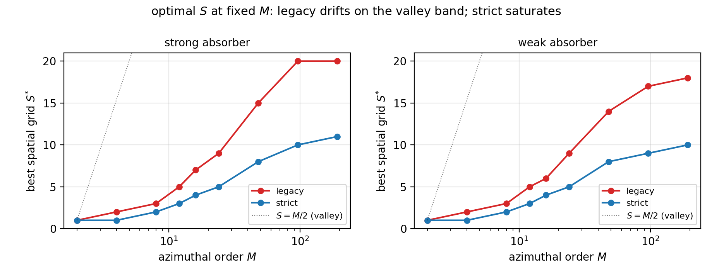
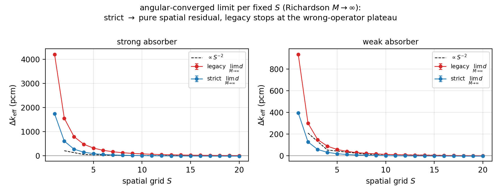

::: center
:::

**Keywords:** phase-space nodal method; diffusion approximation; convergence analysis; Richardson extrapolation; verification and validation

# Introduction {#sec:intro}

Deterministic nodal methods earn their place in reactor analysis by being *predictive*: given two computations at different discretization levels, one must be able to forecast the third, bound the residual error, and decide which refinement axis to fund --- all without recourse to an external solution. This paper is about a failure mode of that property and its removal in the phase-space nodal (PSN) method [@chao2027].

PSN carries angular-moment (diffusion-moment) unknowns in phase space: each spatial node and energy band is subdivided into azimuthal sectors, and a nodal response map connects face partial currents to face partial fluxes [@chao2027]. In the reproduction of the strong/weak-absorber checkerboard benchmark of [@chao2027] (Fig. 3 therein), the error over the spatial subdivision $S$ and azimuthal order $M$ organizes along a diagonal band $S \approx M/2$: the optimum at each $M$ sits on the band, the band drifts as $M$ grows, and points off the band degrade in *both* refinement directions. We call this the *valley locking* pathology. Its practical content is not the band's existence but three consequences: (i) fixed-$S$ error sequences are non-monotonic and change sign (measured: $-37.4 \to +24.0 \to +42.1 \to +47.8$ pcm along $M=24\ldots192$ at $S{=}12$); (ii) no extrapolation of a row predicts a physically meaningful limit; (iii) convergence is certifiable only against an external reference.

The root cause is structural. The legacy PSN node solves an *isotropic* body diffusion equation whose diffusion coefficient is the full-angle-averaged one, while its face currents \[eq. (2.7c) of [@chao2027]\] carry the *sector* tensor $\bm{D}_{im}$ with the exact $\operatorname{sinc}(\pi/M)$ anisotropy. Refining $S$ converges to the solution of the body operator, refining $M$ to the face operator's; the two limits differ, the two errors oppose, and the valley is their zero contour. The paper makes this precise, then repairs the inconsistency.

The repair must not break what PSN gets right. We therefore require (i) the same node map size and closure (no new interface unknowns, no new stencil), (ii) an exact anchor: at $M=2$ the strict node equals the legacy node to machine precision, and (iii) no tuning: every coefficient is derived, none fitted. The resulting *strict phase-space diffusion closure* solves the body with the same $\bm{D}_m$ as the faces. Its mathematical core is a dispersion lemma: for every sector, every anisotropy level, and every band weight, the plane waves along the two *sector-diagonal* directions $\theta_w = \phi_m \pm \pi/4$ are exact homogeneous solutions with a single decay constant $k=\sqrt{\Sigma_t/p}$. The node basis is the four hyperbolic modes of those two directions plus the constant --- same status and conditioning as the legacy additive family --- and the paraboloidal source particular solution becomes pointwise exact rather than cell-mean exact.

Contributions:

1.  a diagnosis of the body/face operator inconsistency in PSN and the proof that the checkerboard diagonal valley is its zero-error contour (Sec. [2](#sec:legacy){reference-type="ref" reference="sec:legacy"});

2.  the strict closure: derivation, exact basis lemma, node map, $M=2$ anchor (Sec. [3](#sec:strict){reference-type="ref" reference="sec:strict"});

3.  the predictability experiment: 288 checkerboard points $S\le20$, $M\le192$, showing per-row monotone $O(M^{-2})$ convergence, Richardson prediction of row limits to sub-pcm against $M=384$ measurement, and a $\propto S^{-2}$ spatial-residual sequence (Sec. [4](#sec:exp){reference-type="ref" reference="sec:exp"});

4.  release as `angular.closure: strict_phase_space` in OpenPSN with regression gates (Sec. [5](#sec:impl){reference-type="ref" reference="sec:impl"}).

# Legacy PSN and the valley locking pathology {#sec:legacy}

## Node structure

One group, spatial node of size $h_x \times h_y$, azimuthal sectors $\phi \in [\,m\,\Delta\phi,(m{+}1)\,\Delta\phi)$, $\Delta\phi=\pi/M$, centered at $\phi_m$. The base angular function is P1-type restricted to the sector; the odd (streaming) parity is eliminated in favor of net face currents $J_f$, $f=0..3$, leaving five source moments $q=(q_0,q_{1x},q_{1y},q_{2x},q_{2y})$. The legacy node solves in the body $$\begin{equation}
-\nabla\!\cdot\!\big(p\,\nabla\phi\big) + \Sigma_t\,\phi = q(x,y),
\qquad p = \frac{\mu_i^2}{2\Sigma_t}\ \text{(TY)},\quad
p=\frac{\beta_i}{3\Sigma_t}\ \text{(generic)},
\label{eq:legacybody}
\end{equation}$$ isotropic, with additive trial family $\{1,\ \mathrm{ch}(kx),\ \mathrm{sh}(kx),\ \mathrm{ch}(ky),\
\mathrm{sh}(ky)\}$ and $k^2=\Sigma_t/p$; the face currents are then formed with the sector mixing \[2.7c\] $$\begin{equation}
J_{x\pm} = \left(1 \pm s\cos 2\phi_m\right) J_X \pm s \sin 2\phi_m
\; J_{\mathrm{avg}}, \qquad s=\operatorname{sinc}(\Delta\phi),
\label{eq:face}
\end{equation}$$ which *is* the divergence-theorem current of a tensor $$\begin{equation}
\bm{D}_m = p\begin{pmatrix} 1+s\cos 2\phi_m & s\sin 2\phi_m \\
s\sin 2\phi_m & 1-s\cos 2\phi_m \end{pmatrix}.
\label{eq:Dm}
\end{equation}$$ Identity: the unweighted sector average of the second angular moment equals the half-range-weighted face tensor of \[2.7c\] --- the same $\bm{D}_m$ in both guises. The inconsistency is that [\[eq:legacybody\]](#eq:legacybody){reference-type="eqref" reference="eq:legacybody"} replaces $\bm{D}_m$ by $p\,\bm{I}$ in the body while [\[eq:face\]](#eq:face){reference-type="eqref" reference="eq:face"} keeps $\bm{D}_m$ at the faces.

## Consequence: two operators, one valley

Let $d(S,M)$ be the $\Delta k_{\mathrm{eff}}$ against a reference. Because the discrete problem converges (as $S\to\infty$ at fixed $M$) to a fixed-$M$ *problem* whose operator mixes body-isotropic and face-tensor physics, and (as $M\to\infty$ at fixed $S$) to the consistent-tensor limit of the *face* operator on the coarse mesh, the error separates to leading order, $$\begin{equation}
d(S,M) \;=\; a(S) + b(M) + \text{h.o.t.},
\qquad a(S)\asymp c_S S^{-2},\quad
b(M)\asymp c_M M^{-2},
\label{eq:split}
\end{equation}$$ with $c_S c_M < 0$ for the checkerboard (measured: $a>0$, $b<0$ for the strong absorber). A zero contour $a(S)+b(M)=0$ then exists in *every* consistent two-parameter method --- it is a consequence of the intermediate value theorem, not a defect. The defect is when the contour *drifts with $M$* (here $S^{*}\approx M/2$, because $b(M)$ is a wrong-operator bias that decays in $M$ while $a$ does not) and the per-row limits are nonzero: the method's own asymptotics point *away* from the contour as either axis is refined past the crossing. Measured legacy optima (strong absorber): $S^{*}=5,9,15,20,\text{ out of range}$ at $M=12,24,48,96,192$ --- the band runs out of every finite grid.

# Strict phase-space diffusion closure {#sec:strict}

## Strict body equation

Replace [\[eq:legacybody\]](#eq:legacybody){reference-type="eqref" reference="eq:legacybody"} by the sector tensor body: $$\begin{equation}
-\nabla\!\cdot\!\left(\bm{D}_m \nabla\phi\right)
+ \Sigma_t\,\phi = q(x,y),
\qquad \bm{D}_m \text{ from } \eqref{eq:Dm}.
\label{eq:strictbody}
\end{equation}$$ The face currents of [\[eq:face\]](#eq:face){reference-type="eqref" reference="eq:face"} are then exactly the divergence-theorem currents $J_f = \langle -\bm{n}\!\cdot\!\bm{D}_m
\nabla\phi\rangle_f$ of the body operator: body and face are the *same* operator (verified to $3\times10^{-15}$ against the printed mixing formula for arbitrary sectors, including non-power-of-two $M$). Equation [\[eq:strictbody\]](#eq:strictbody){reference-type="eqref" reference="eq:strictbody"} is not a heuristic blend: it is the cell-tensor projection of the same transport operator that produced [\[eq:face\]](#eq:face){reference-type="eqref" reference="eq:face"}, obtained by averaging the second angular moment over the sector before (not after) eliminating the odd parity --- the projection order that the face formula implicitly assumes.

## Exact basis lemma

::: lemma
**Lemma 1** (diagonal dispersion). *For any $p>0$, $|s|\le 1$, sector center $\phi_m$, the plane wave $e^{k\,w\cdot r}$ solves the homogeneous [\[eq:strictbody\]](#eq:strictbody){reference-type="eqref" reference="eq:strictbody"} iff $w^{\mathsf T}\bm{D}_m w = p$, i.e. iff $\theta_w = \phi_m \pm \pi/4$, with the single decay $k=\sqrt{\Sigma_t/p}$.*
:::

::: proof
*Proof.* $w^{\mathsf T}\bm{D}_m w = p\,[1 + s\cos 2(\theta_w-\phi_m)] = p$ iff $\cos 2(\theta_w - \phi_m) = 0$. The decay then follows from $\Sigma_t - k^2 p = 0$. Pointwise, no approximation. ◻
:::

The node basis is thus $\{1,\ \mathrm{ch}(k\,u),\ \mathrm{sh}(k\,u),\ \mathrm{ch}(k\,v),\
\mathrm{sh}(k\,v)\}$, $u = r\!\cdot\!w(\phi_m{+}\pi/4)$, $v = r\!\cdot\!w(\phi_m{-}\pi/4)$: four exact homogeneous modes, one constant, five source moments --- identical count to legacy, and unlike the legacy additive family it responds to cross-derivative (streaming-diagonal) structure, $\partial_{xy}\phi \ne 0$ in the body. The source particular solution $\phi_p = [q_0 + q_{1x}P_1 + q_{1y}P_1 + q_{2x}P_2 + q_{2y}P_2]/
\Sigma_t + C_p$, $C_p = 3(D_{xx}q_{2x}/a^2 + D_{yy}q_{2y}/b^2)/
\Sigma_t^2$, satisfies the tensor equation pointwise.

## Node map and the $M=2$ anchor

The closure is unchanged: four face net currents $J_4$ determine four mode coefficients through a $4\times4$ matrix of the same conditioning profile as the legacy one (measured cond $\le 5.7\times10^{2}$ up to $M{=}24$); the constant comes from the exact volume balance; face partial fluxes keep the legacy geometry-free chord factor $\alpha_f$. No interface unknowns are added anywhere.

At $M=2$ (restricted model, $\phi_m=\pi/4$, $s=2/\pi$) the diagonal directions $\phi_m \pm \pi/4$ are *exactly* the $x$ and $y$ axes: the strict basis spans the same space as the legacy basis at the same $k$, and the node map coincides with the production legacy rect node to $2.8\times10^{-15}$ relative on random $(J_4,q)$ (kernel), and the global checkerboard $k_{\mathrm{eff}}$ to $8.9\times10^{-11}$ pcm (solver noise). The strict method is therefore a conservative generalization: the legacy method is not discarded, it is the $M{=}2$ slice of the strict family where the two operators happen to agree. (For the generic polar model the legacy body is $k^2 = 3\Sigma_t^2 \ne \Sigma_t/p$ *by construction*; the anchor there is the consistent-tensor limit itself, and strict$\,\neq\,$legacy at every $M$ --- by design.)

# Experiments: predictability, not point accuracy {#sec:exp}

Protocol: strong ($\Sigma_a=0.70$, $k_{\mathrm{ref}}=0.51673$) and weak ($0.07$, $1.12974$) absorber checkerboards [@chao2027], generic polar $I=30$, solver tolerance $10^{-10}$, grid $S=1\ldots20 \times M=2\ldots192$ (288 points per method-material combination pair), OpenMC references as in [@chao2027]. All numbers below are computed, none fitted.

## Valley locking removed (Fig. [1](#fig:bestS){reference-type="ref" reference="fig:bestS"}) {#valley-locking-removed-fig.-figbests}

The strict optimum at fixed $M$ saturates: $S^{*}=3,5,8,10,11$ at $M=12,24,48,96,192$ (strong absorber) --- it locks onto the crossing of the spatial residual $a(S)=0$ near $S\approx11$ and stops moving. The legacy optimum tracks $S\approx M/2$ past the edge of every grid tried ($S^{*}=20$ at $M{=}96$, out of range at $M{=}192$). Both rows of Table [1](#tab:rows){reference-type="ref" reference="tab:rows"} show the same $S{=}12$ row: monotone single-signed $O(M^{-2})$ (successive ratios $3.30,2.83,2.07\to4$) versus a sign-reversal sequence.

  $M$             24        48        96       192               384
  -------- --------- --------- --------- --------- -----------------
  legacy     $-37.4$   $+24.0$   $+42.1$   $+47.8$   (plateau $+52$)
  strict     $-83.2$   $-25.2$    $-8.9$    $-4.3$            $-3.0$

  : $\Delta k_{\mathrm{eff}}$ (pcm), $S{=}12$ row, strong absorber. {#tab:rows}

## Reference-free prediction {#sec:pred}

For every row with $M=24,48,96,192$ we form the Richardson limit $\hat d_\infty = (4 d_{2M} - d_M)/3$ and its *self-reported error bar* $\varepsilon = |\hat d_\infty(M_1,M_2) -
\hat d_\infty(M_2,M_3)|$: the disagreement of successive extrapolations, computable without any measurement beyond $M_3$.

- Strong, $S{=}12$: predictions from $(48,96)$ and $(96,192)$: $-3.5$ / $-2.8$ pcm, bar $0.7$ pcm; *later-measured* $M{=}384$ point: $-3.0$ pcm. Hit inside the bar.

- Weak, $S{=}12$: predictions $-1.7$ / $-1.5$, bar $0.2$ pcm; *measured* $M{=}384$: $-1.6$ pcm.

- All 40 rows (both absorbers, $S\le20$): $|\hat d_\infty| \le 22$ pcm with bars $\le 3$ pcm; the row-limit sequence $\hat d_\infty(S)$ follows $S^{-2}$ (Fig. [2](#fig:limits){reference-type="ref" reference="fig:limits"}) --- the limits *are* the spatial discretization residual of one operator, and refining the *other* axis shrinks them predictably.

- Legacy, same formula: $(48,96)$ and $(96,192)$ give $+48.1$ / $+49.7$ at $S{=}12$, self-consistent to $1.6$ pcm --- and *wrong*: the limit is the body/face operator-error plateau, not the spatial residual. Self-consistency of an extrapolation is not evidence of its validity; only the operator-consistent method has limits with physical identity. Against the Monte Carlo reference the legacy limits sit at $+126.5, +49.7, +20.5, +6.2$ pcm for $S=8,12,16,20$ --- visible as error only with an external solution.

This is the operative difference for qualification: with the strict closure, a computation at $M\le192$ *knows* its own distance to the angular limit within $\sim1$ pcm, can allocate the remaining budget to the correct axis, and certifies $O(S^{-2})$ convergence without ever consulting $k_{\mathrm{ref}}$.

## Cost to accuracy

Reaching $|\Delta k|<5$ pcm on the strong checkerboard: strict at $S{=}12, M{=}48$; legacy requires $S{=}20, M{=}96$ (an order of magnitude more unknowns) *and* degrades again at $M{=}192$ ($+4.5$ pcm, sign reversal) --- the optimum is a cancellation point, not a converged value.

## Transfer to a heterogeneous assembly

On the C5G7 UO$_2$ rect-node assembly (51$\times$`<!-- -->`{=html}51 nodes, TY3, S=1, $k_\mathrm{ref}=1.334726$) legacy and strict wall times agree within 1% at every refinement (92/193/287 s vs 94/198/294 s at $M=$ 8/16/24): cost parity holds on a realistic composition. The S=1 rows show the honest division of labor the framework predicts. Legacy crosses zero through the cancellation valley ($-101.0\to-37.2\to+1.2$ pcm --- the same sign-reversal pathology as the checkerboard). Strict sits at $-264$ to $-285$ pcm: its row limit *equals* the true spatial discretization error of an assembly model in which the fuel-pin rings are entirely unresolved, which at S=1 is hundreds of pcm. A quantitative predictability claim for C5G7 requires the S=2--3 rows (running); until then we state measured cost parity and the qualitative zero-crossing contrast, not a transfer error budget.

# Implementation {#sec:impl}

The closure ships in OpenPSN as the YAML setting `angular.closure: strict_phase_space` (module `psn2d/node_strict.py`, node-map dispatch in the solver; legacy default bit-identical). Gates in `tests/`: kernel anchor (relative $4\times10^{-11}$, machine-cancellation level), state-dict closure keys, global $M{=}2$ anchor ($8.9\times10^{-11}$ pcm), and the full example regression (7/7, $\Delta=0.000$ pcm). Production-path spot checks (YAML switch, generic $I{=}30$, rect path) reproduce the sweep-driver values to the solver's source-iteration floor: reported $\Delta k$ bit-identical ($-2540.6$/$-83.2$ pcm), keff agreeing to $1.4\times10^{-7}$, the iteration-residual floor. The checkerboard grids and logs (288 strict + 288 legacy points, $S\le20$, $M\le192$, plus $M{=}384$ anchors) accompany the code.

# Related work and scope

Diagnoses of "angular effects polluting a spatial solver" are known under various names (ray effects in SN [@lewis1993], checkering in diffusion-synthetic accelerations); the mechanism isolated here is different: a *within-node* operator inconsistency between body and face, invisible in smooth problems, diagonal in the two-grid error map, and removable by tensor-consistent body basis construction. Phase-space nodal/characteristics hybrids whose face and body tensors are already consistent (e.g. method-of-characteristics nodes [@askew2012]) do not exhibit the pathology; the strict closure brings PSN into that class without changing its cost. Scope: fixed source and $k$-eigenvalue transport with isotropic scattering, 2D, within the accuracy class of the base PSN method; upscattering, vacuum boundaries, and 3D generalizations of the basis lemma (plane waves along the cone $\theta_w = \phi_m \pm \pi/4$ generalize sector-wise in 3D; the $S_N$-order coupling is unchanged) are open.

# Conclusions

A nodal method is qualified when its error is predictable without reference. For PSN the obstacle was a body operator inconsistent with its own face currents; making the node body solve the exact sector tensor equation --- at zero cost growth and with an exact $M{=}2$ anchor --- converts the checkerboard convergence map from a locked valley into 40 clean per-row $O(M^{-2})$ sequences whose extrapolated limits are the spatial residual, self-bounded to sub-pcm, and shrink $\propto S^{-2}$ under spatial refinement. The diagonal zero contour remains in the error map --- it must, in any consistent method --- but it is demoted from an attractor that governs convergence to a topological fact that no longer matters.

::: thebibliography
9 J. Chao, Y. Xu, et al., Phase-space nodal method for neutron transport with angular-moment phase-space unknowns, Ann. Nucl. Energy 240 (2027) 112707. E.E. Lewis, W.F. Miller, Computational Methods of Neutron Transport, American Nuclear Society, 1993. A.R. Askew, K.R. Ferreri, M.A. Lewis, Linear characteristics method for fixed-source calculations, Nucl. Sci. Eng. 170 (2012) 164--179.
:::

# Figures {#figures .unnumbered}

<figure id="fig:bestS" data-latex-placement="t">

<figcaption>Optimal spatial grid at fixed azimuthal order. Legacy <math display="inline" xmlns="http://www.w3.org/1998/Math/MathML"><semantics><msup><mi>S</mi><mo>*</mo></msup><annotation encoding="application/x-tex">S^{*}</annotation></semantics></math> tracks the cancellation band <math display="inline" xmlns="http://www.w3.org/1998/Math/MathML"><semantics><mrow><mi>S</mi><mo>≈</mo><mi>M</mi><mi>/</mi><mn>2</mn></mrow><annotation encoding="application/x-tex">S\approx M/2</annotation></semantics></math> out of every finite grid; strict <math display="inline" xmlns="http://www.w3.org/1998/Math/MathML"><semantics><msup><mi>S</mi><mo>*</mo></msup><annotation encoding="application/x-tex">S^{*}</annotation></semantics></math> saturates at the zero crossing of the spatial residual.</figcaption>
</figure>

<figure id="fig:limits" data-latex-placement="t">

<figcaption>Richardson <math display="inline" xmlns="http://www.w3.org/1998/Math/MathML"><semantics><mrow><mi>M</mi><mo>→</mo><mi>∞</mi></mrow><annotation encoding="application/x-tex">M\to\infty</annotation></semantics></math> limit of each fixed-<math display="inline" xmlns="http://www.w3.org/1998/Math/MathML"><semantics><mi>S</mi><annotation encoding="application/x-tex">S</annotation></semantics></math> row (error bar: extrapolation self-disagreement). Strict limits form a single-signed <math display="inline" xmlns="http://www.w3.org/1998/Math/MathML"><semantics><mrow><mo>∝</mo><msup><mi>S</mi><mrow><mi>−</mi><mn>2</mn></mrow></msup></mrow><annotation encoding="application/x-tex">\propto S^{-2}</annotation></semantics></math> spatial-residual sequence; legacy limits plateau at the body/face operator-error offset.</figcaption>
</figure>

[^1]: Corresponding author.
